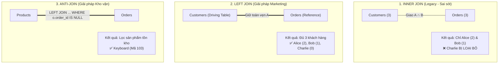

# Khủng Hoảng Chiến Dịch Marketing Tại FlashMart - Khi Lệnh JOIN "Đánh Cắp" Dữ Liệu Khách Hàng

> **Dự án:** Sàn thương mại điện tử FlashMart &bull; Chiến dịch Siêu Sale Cuối Năm  
> **Vai trò:** Data Engineer (Kỹ sư dữ liệu phục hồi hệ thống)  
> **Cơ sở dữ liệu:** MySQL 8.0+ / InnoDB  
> **Kho lưu trữ:** `https://github.com/imvoka3701/flashmart.git`

---

## 📌 Bối Cảnh Dự Án & "Thảm Họa" Dữ Liệu

Trước thềm đại tiệc Siêu Sale cuối năm tại sàn thương mại điện tử FlashMart, Ban giám đốc đã đưa ra hai yêu cầu truy xuất dữ liệu tối khẩn cấp:
1. **Giám đốc Marketing:** *"Cần danh sách toàn bộ khách hàng đã đăng ký tài khoản, kèm số lượng đơn hàng đã mua. Những người chưa từng mua hàng sẽ được phát Voucher 50% để kích cầu."*
2. **Giám đốc Kho vận:** *"Kho đang quá tải nghiêm trọng. Cần danh sách các sản phẩm chưa từng được bán ra lần nào để tiến hành thanh lý thu hồi vốn."*

### ⚠️ Sai lầm chí mạng của Lập trình viên tập sự
Lập trình viên trước đó đã sử dụng duy nhất câu lệnh `JOIN` (mặc định là `INNER JOIN`) cho cả hai báo cáo:
* **Hậu quả 1 (Marketing):** Báo cáo bị mất tích hoàn toàn khách hàng **Charlie** (người chưa từng mua hàng) vì `INNER JOIN` loại bỏ tất cả các dòng không khớp. Chiến dịch phát voucher 50% kích cầu bị phá sản!
* **Hậu quả 2 (Kho vận):** Báo cáo trả về **0 dòng (rỗng)** vì điều kiện `WHERE o.order_id IS NULL` mâu thuẫn hoàn toàn với tập kết quả không-NULL của `INNER JOIN`. Sản phẩm tồn kho **Keyboard (103)** không được phát hiện!

---

## 📐 Phân Tích Logic & Lý Thuyết Tập Hợp (Set Theory)



### Điểm khác biệt cốt tử giữa `COUNT(*)` và `COUNT(o.order_id)`:
Sau phép `LEFT JOIN`, dòng của khách hàng Charlie có cấu trúc:
$$\text{(customer\_id: 3, name: 'Charlie', order\_id: NULL, product\_id: NULL)}$$

* ❌ **`COUNT(*)`:** Đếm số lượng hàng vật lý của nhóm. Do dòng Charlie tồn tại trong bảng tạm, hàm sẽ trả về **1 đơn hàng** $\rightarrow$ **SAI NGHIỆP VỤ**.
* ✅ **`COUNT(o.order_id)`:** Đếm số lượng ô mang giá trị khác `NULL`. Vì `o.order_id` là `NULL`, hàm trả về **0 đơn hàng** $\rightarrow$ **CHÍNH XÁC 100%**.

---

## 💻 Mã Nguồn SQL Đã Tối Ưu Hóa (Solution Queries)

### 1. Báo cáo Marketing: Danh sách toàn bộ khách hàng & Số đơn
```sql
SELECT 
    c.customer_id, 
    c.name, 
    COUNT(o.order_id) AS total_orders,
    CASE 
        WHEN COUNT(o.order_id) = 0 THEN 'Tặng Voucher 50% (Khách hàng tiềm năng)'
        ELSE 'Khách hàng thân thiết'
    END AS marketing_action
FROM Customers c
LEFT JOIN Orders o ON c.customer_id = o.customer_id
GROUP BY c.customer_id, c.name
ORDER BY c.customer_id ASC;
```

**Kết quả đối chiếu (3 dòng đầy đủ):**
| customer_id | name | total_orders | marketing_action |
| :---: | :--- | :---: | :--- |
| **1** | Alice | 2 | Khách hàng thân thiết |
| **2** | Bob | 1 | Khách hàng thân thiết |
| **3** | Charlie | **0** | **Tặng Voucher 50% (Khách hàng tiềm năng)** |

---

### 2. Báo cáo Kho vận: Danh sách sản phẩm ế cần thanh lý (Anti-Join)
```sql
SELECT 
    p.product_id, 
    p.product_name,
    'Chưa từng phát sinh giao dịch - Đề xuất thanh lý' AS inventory_status
FROM Products p
LEFT JOIN Orders o ON p.product_id = o.product_id
WHERE o.order_id IS NULL;
```

**Kết quả đối chiếu (1 dòng chính xác):**
| product_id | product_name | inventory_status |
| :---: | :--- | :--- |
| **103** | Keyboard | Chưa từng phát sinh giao dịch - Đề xuất thanh lý |

---

## 🛡️ Bộ Câu Hỏi Vấn Đáp Với Giám Đốc Dữ Liệu (CDO Defense)

Chi tiết giải trình đầy đủ tại file [`join_analysis.md`](file:///C:/Users/ductr/.gemini/antigravity-ide/scratch/flashmart/join_analysis.md):
1. **Sự khác biệt INNER JOIN và LEFT JOIN? Nếu đổi thành RIGHT JOIN thì sao?**
   * `INNER JOIN` chỉ lấy phần giao. `LEFT JOIN` bảo tồn 100% bảng gốc (Driving Table).
   * Nếu viết `Customers RIGHT JOIN Orders`, `Orders` sẽ trở thành bảng gốc, Charlie tiếp tục bị bốc hơi vì không có trong `Orders`.
2. **Tại sao `WHERE o.order_id IS NULL` bắt buộc phải đi kèm LEFT JOIN?**
   * Vì `LEFT JOIN` mới tạo ra các dòng chứa `NULL` ở bảng phụ cho các bản ghi không khớp. Nếu đổi thành `INNER JOIN`, kết quả sẽ luôn luôn khác `NULL`, làm cho điều kiện `IS NULL` dẫn tới tập rỗng (0 dòng).
3. **Cross Join (Tích Descartes) là gì và khi nào gây treo hệ thống?**
   * Là phép nhân chập mọi dòng bảng A với bảng B ($M \times N$). Xảy ra khi quên mệnh đề `ON`, quên `WHERE` trong Implicit Join, hoặc điều kiện luôn đúng (`ON 1=1`). Khi bảng có hàng triệu dòng, nó sinh ra hàng tỷ dòng dữ liệu làm tràn RAM và treo máy chủ MySQL.

---

## 🚀 Hướng Dẫn Vận Hành & Đồng Bộ Git

```bash
# Di chuyển vào thư mục dự án
cd "C:\Users\ductr\.gemini\antigravity-ide\scratch\flashmart"

# Kiểm tra trạng thái Git
git status

# Đẩy mã nguồn lên kho chứa GitHub
git push -u origin main
```
